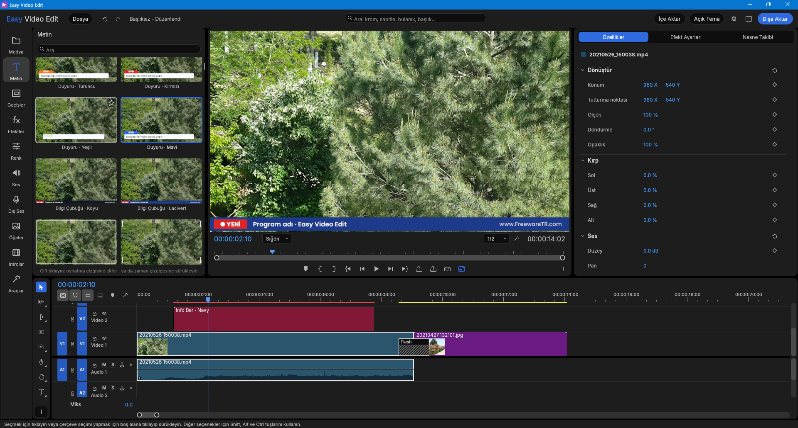

<p align="center">
  
</p>

<h1 align="center">Easy Video Edit</h1>

<p align="center">
  <b>A simple, visual video editor with professional power underneath. Open source, written in pure Rust.</b>
</p>

<p align="center">
  <a href="https://www.freewaretr.com/app/easyvideoedit"></a>
</p>

<p align="center">
  
  
  
</p>

Easy Video Edit puts everything you need on one screen: a rail of categories on the left, one
preview in the middle, the selection's properties on the right and a layered timeline at the
bottom. Pick a card, see it move, double-click it or drag it onto the timeline. No ads, no
watermark, no subscription.

It is a fork of [FilmCraft](https://github.com/storytold/filmcraft), the open-source, Premiere-style
editor written from scratch in Rust: FilmCraft's engine does the decoding, compositing, effects and
export, and FilmCraft's full layout is still one click away (the layout icon in the top bar).

<p align="center">
  
</p>

## What's inside

| Category | What you get |
|---|---|
| **Media** | Import video, audio and pictures; proxies for slower computers |
| **Text** | About 150 animated templates: titles in 24 styles and 4 animations, lower thirds, subtitle styles, social media calls, labels, chapter titles, quotes, closing cards |
| **Transitions** | Every transition as a card that plays its own preview, with favorites and groups |
| **Effects** | Video effects with live previews |
| **Color** | Ready-made looks, and full color grading under *Adjust* |
| **Audio** | Audio effects (noise reduction, EQ, dynamics…), audio transitions, sound settings |
| **Voiceover** | Text to speech |
| **Elements** | Arrows, icons, faces, highlights, speech and thought bubbles, stickers |
| **Intros** | Twelve editable openings: Sunset, Neon Night, Cinema Bars, Corporate, Retro, Game, Elegant, Sport, Vlog… |
| **Tools** | Crop, rotate, zoom, speed, chroma key, masks, motion and the rest of FilmCraft's effect controls |

Every template's text, colours and font can be changed in *Properties*. Its sample text follows the
interface language.

## Languages

The interface uses FilmCraft's translation catalogues (`crates/ui-egui/src/i18n/*.tsv`): English,
Turkish, German, French, Spanish, Italian, Portuguese, Polish, Czech, Ukrainian, Russian, Japanese,
Korean, Chinese and more. Easy Video Edit's own strings are English in the code and translated in
the same catalogues, so adding a language is adding rows to one file.

## Build

You need Rust 1.95 or newer.

```sh
git clone https://github.com/erolsavas19/easy-video-edit
git clone -b videokurgu https://github.com/erolsavas19/craft-fonts easy-video-edit-fonts
cd easy-video-edit
CRAFT_FONTS_DIR="$(pwd)/../easy-video-edit-fonts" cargo build --release -p filmcraft
```

On Windows (PowerShell): `$env:CRAFT_FONTS_DIR = "C:\path\to\easy-video-edit-fonts"` before
`cargo build`. Without `CRAFT_FONTS_DIR` the app still builds and runs; the templates then fall back
to the bundled Inter, Noto Serif and JetBrains Mono faces.

The fonts (display faces for the templates, every one checked for all Turkish letters) are open
licences only (OFL-1.1, Apache-2.0) and listed in that repository's `ATTRIBUTION.md`.

## Türkçe

Easy Video Edit, videolarını kolayca düzenlemek isteyenler için hazırlanmış, açık kaynaklı ve
ücretsiz bir video düzenleyicidir. Son yıllarda çok sevilen, şablon ağırlıklı ve "seç, sürükle,
dışa aktar" mantığıyla çalışan kolay düzenleyicilerin rahatlığını sunar; ama ücretsizdir, açık
kaynaklıdır ve altında profesyonel bir video motoru (FilmCraft) çalışır. Profesyonel kurgu
programlarının yerini alma iddiası yoktur; gündelik video işlerinin büyük çoğunluğunu en kolay
yoldan halletmeyi amaçlar.

Arayüz Türkçe kullanılabilir; şablonların örnek yazıları da arayüz diline göre Türkçe gelir.
Reklam, filigran ya da abonelik yoktur; videolarınız hiçbir yere yüklenmez.

## License and credits

MIT OR Apache-2.0, like FilmCraft. Easy Video Edit is based on
[FilmCraft](https://github.com/storytold/filmcraft) by the FilmCraft contributors; FilmCraft's
original README is in [docs/filmcraft-README.md](docs/filmcraft-README.md). Every asset is listed in
[ATTRIBUTION.md](ATTRIBUTION.md). FilmCraft's ArtCraft brand marks are not part of this fork.
